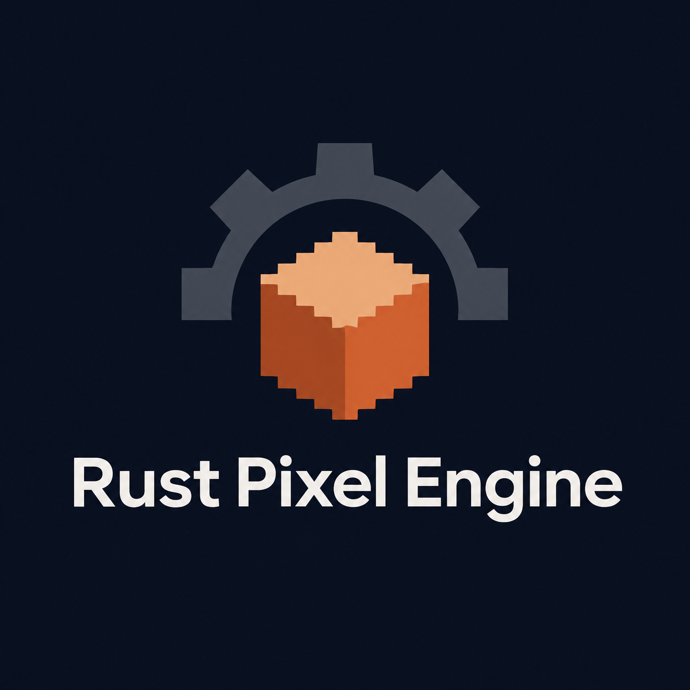

# RustPixelEngine

Rust 코드로 2D 도트 게임을 만드는 경량 엔진을 목표로 하는 Rust 2024 프로젝트입니다. 모듈화, 픽셀 단위의 일관성, 선택 가능한 CPU·GPU·Hybrid 렌더링과 선택적 게임 시스템을 지향합니다.

**현재 상태:** 창과 게임 루프의 기반이 구현되어 있습니다. 렌더링, 스프라이트, 오디오와 게임 프레임워크는 계획 단계입니다. 현재 창은 픽셀이나 게임 화면을 그리지 않습니다.

## 현재 기능

- winit 기반 창 생성 및 닫기, 크기·포커스 이벤트 처리
- `Game::init`, `update`, `shutdown` 생명주기
- 물리 키보드 상태와 전이, 프레임 시간, 경과 시간 및 종료 요청
- 명시적인 설정·플랫폼·게임 초기화 오류와 `log` 진단

런타임은 약 16.67ms 간격으로 업데이트를 예약합니다. 이는 고정 시간 간격 시뮬레이션이 아니며 지연된 업데이트를 보충하지 않습니다. Windows를 우선 대상으로 하며 플랫폼별 실행 검증 결과는 아직 기록되지 않았습니다.

## 시작하기

Rust 2024 Edition을 지원하는 툴체인과 Cargo, 창을 표시할 수 있는 데스크톱 환경이 필요합니다. 저장소에는 Rust 툴체인 설정이 포함되어 있습니다.

```sh
cargo run -p hello-window
cargo run -p cpu-renderer-example
cargo run -p rust-pixel-engine --example keyboard
```

첫 명령은 창과 생명주기 예제, 두 번째는 키보드 예제입니다. 외부 게임 프로젝트에서는 저장소 위치에 맞춰 경로 의존성을 지정할 수 있습니다.

```toml
[dependencies]
rust-pixel-engine = { path = "../RustPixelEngine/crates/rpe" }
```

## 최소 예제

```rust
use rust_pixel_engine::prelude::*;

struct MyGame;

impl Game for MyGame {
    fn init(ctx: &mut Context) -> Result<Self, GameError> {
        println!("논리 해상도: {:?}", ctx.logical_size());
        Ok(Self)
    }

    fn update(&mut self, ctx: &mut Context, dt: f32) {
        if ctx.input().just_pressed(Key::Space) {
            println!("Space: delta = {dt:.4}초");
        }
        if ctx.input().just_pressed(Key::Escape) {
            ctx.request_exit();
        }
    }

    fn shutdown(&mut self, ctx: &mut Context) {
        println!("업데이트 횟수: {}", ctx.time().frame_count());
    }
}

fn main() -> Result<(), EngineError> {
    Engine::builder()
        .title("My Game")
        .resolution(320, 180)
        .window_size(1280, 720)
        .run::<MyGame>()
}
```

`init`만 필수이며 나머지 콜백에는 기본 구현이 있습니다. 기본 논리 해상도는 320×180, 창 크기는 1280×720입니다. 크기의 각 차원은 0보다 커야 합니다. 논리 해상도는 현재 설정으로 보관될 뿐 렌더링에 사용되지 않습니다.

## 입력과 시간

`ctx.input().pressed(key)`는 현재 눌림 상태를, `just_pressed`와 `just_released`는 마지막 업데이트 이후의 전이를 나타냅니다. 같은 구간에 누르고 놓으면 두 전이가 모두 기록됩니다. 포커스를 잃으면 눌린 키가 해제됩니다. 영문자, 숫자, 방향키, 주요 제어키와 좌우 수정자 키의 물리 위치를 지원하며 매핑되지 않은 키는 무시합니다.

`ctx.time().delta_seconds()`는 마지막 갱신 기준으로부터의 초, `elapsed_seconds()`는 생성 이후 경과 초, `frame_count()`는 업데이트 횟수입니다. 일시 중단 후 재개 시 delta 기준은 재설정되지만 경과 시간에는 중단 기간이 포함됩니다.

창 크기는 `window_size()`에서 마지막으로 보고된 물리 픽셀 크기로, 논리 해상도는 `logical_size()`에서 확인합니다. 엔진은 전역 로거를 설치하지 않습니다. 로그가 필요하면 애플리케이션에서 `log` 호환 로거를 설정하세요.

## Workspace 구성

| 크레이트 | 역할 | 상태 |
|---|---|---|
| `rust-pixel-engine` | 공개 진입점과 런타임 조립 | 런타임 구현 |
| `rpe-core`, `rpe-platform` | 생명주기·시간·오류, 창과 이벤트 | 구현 |
| `rpe-input`, `rpe-math` | 키보드 상태, 기본 수학 타입 | 구현 |
| `rpe-render*`, `rpe-assets` | 렌더링 백엔드와 자산 | 계획 |
| `rpe-world`, `rpe-animation`, `rpe-tilemap` | 월드와 콘텐츠 | 계획 |
| `rpe-physics`, `rpe-audio`, `rpe-ui` | 선택적 게임 시스템 | 계획 |

Cargo에 `cpu`, `gpu`, `hybrid` 및 게임 시스템 feature가 선언되어 있지만 해당 기능이 구현되었다는 뜻은 아닙니다. 현재 기본 feature는 `cpu`입니다.

## 개발 문서

- [로드맵](Docs/roadmap.md)과 [Milestone 001](Docs/milestones/milestone001.md)
- [아키텍처](Docs/architecture.md), [API 계약](Docs/api-contracts.md), [렌더링 명세](Docs/rendering-spec.md)
- [002 CPU 렌더러](Docs/milestones/milestone002.md) · [003 입력과 시간](Docs/milestones/milestone003.md) · [004 스프라이트와 자산](Docs/milestones/milestone004.md)
- [005 GPU 렌더러](Docs/milestones/milestone005.md) · [006 Hybrid 렌더러](Docs/milestones/milestone006.md) · [007 게임 프레임워크](Docs/milestones/milestone007.md) · [008 안정화와 릴리스](Docs/milestones/milestone008.md)

## 검증과 라이선스

단위 테스트가 코드에 포함되어 있습니다. 검증 시 `cargo test --workspace`와 GUI 예제를 대상 환경에서 실행하고 결과를 기록합니다. GUI, GPU 및 오디오 검증은 사용 가능한 환경에 따라 별도로 평가해야 합니다.

Workspace 메타데이터의 라이선스 선언은 `MIT OR Apache-2.0`입니다. 배포 전 라이선스 파일과 의존성 검토가 필요하며, 현재 Workspace 패키지는 `publish = false`입니다.
